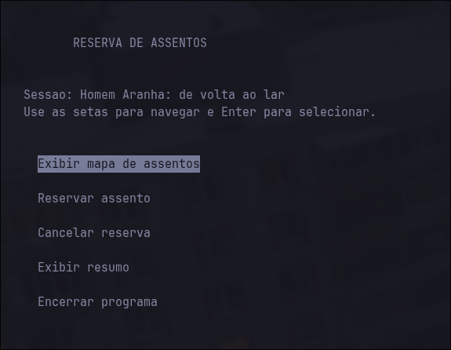
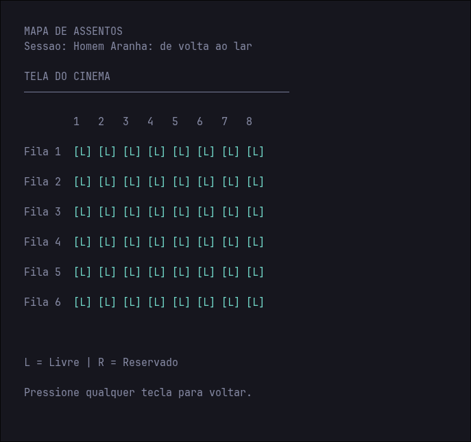
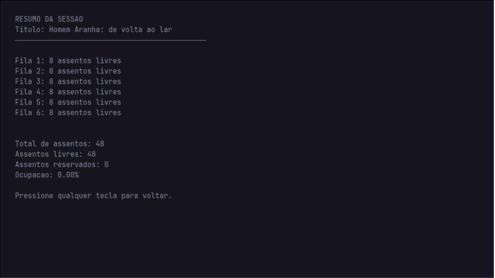

 <div align="center">


# Reserva de Assentos de uma Sessão

Sistema de gerenciamento de reservas desenvolvido em C com interface interativa no terminal utilizando ncurses.


</div>

- **Aluno:** João Paulo de Medeiros Neto
- **Projeto:** Opção 3 — Reserva de Assentos de uma Sessão
- **Disciplina:** Introdução às Técnicas de Programação (ITP)
- **Instituição:** Universidade Federal do Rio Grande do Norte (UFRN)

## Sobre o projeto

O projeto consiste em uma aplicação desenvolvida em linguagem C para controlar a disponibilidade de assentos de uma sessão. O usuário informa o título da sessão, define a quantidade de fileiras e gerencia as reservas por meio de um menu interativo no terminal.

A sala suporta de 1 a 6 fileiras, cada uma com 8 assentos. Os assentos são representados por uma matriz de inteiros, na qual `0` indica um assento livre e `1` indica um assento reservado.

## Funcionalidades

- Cadastro da sessão.
- Exibição do mapa de assentos.
- Reserva de assentos disponíveis.
- Cancelamento de reservas.

## Demonstração visual

<div align="center">

### Menu principal



*Interface de navegação do sistema de reservas.*

### Mapa de assentos



*Visualização dos assentos livres e reservados.*

### Resumo da ocupação



*Informações sobre a disponibilidade e a ocupação da sessão.*

</div>


## Conceitos de programação utilizados

| Conceito | Aplicação no projeto |
|---|---|
| Matrizes | Representação dos assentos da sessão. |
| Strings | Armazenamento do título da sessão. |
| Funções | Organização das operações do programa. |
| Ponteiros | Manipulação de resultados por referência de memória. |
| Alocação dinâmica | Criação de um vetor com `malloc()`. |
| Liberação de memória | Uso de `free()` após a utilização do vetor. |
| Validação | Verificação das entradas e dos limites permitidos. |

## Requisitos

- Compilador GCC.
- Biblioteca ncurses.
- Terminal compatível com ncurses.

No Arch Linux, instale as dependências com:

```bash
sudo pacman -S gcc ncurses
```
Debian, Ubuntu, Mint e derivados
```bash
sudo apt install libncurses5-dev libncursesw5-dev
```
macOS
```bash
brew install ncurses
```

## Compilação e execução

Na pasta do projeto, compile com:

```bash
gcc -std=c11 -Wall -Wextra -pedantic main.c -o reserva -lncurses
```

Execute o programa:

```bash
./reserva
```

## Testes sugeridos

### Teste 1 — Reserva e cancelamento

1. Inicie o programa e informe o título da sessão.
2. Defina a quantidade de fileiras como `3`.
3. Reserve o assento da fileira `1`, posição `2`.
4. Tente reservar novamente o mesmo assento.
5. Cancele a reserva e consulte o mapa.

**Resultado esperado:** a primeira reserva deve funcionar, a duplicação deve ser rejeitada e o cancelamento deve liberar o assento.

### Teste 2 — Entradas inválidas

1. Tente definir `0` ou `7` fileiras.
2. Informe uma quantidade válida.
3. Tente utilizar uma fileira `0` ou um assento `9`.

**Resultado esperado:** as entradas fora dos limites permitidos devem ser rejeitadas.

## Vídeo de apresentação

**Link:** adicione aqui a URL pública do vídeo no YouTube após a publicação.

## Referências

- [Documentação da biblioteca ncurses](https://invisible-island.net/ncurses/)
- [Referência da linguagem C — cppreference](https://en.cppreference.com/w/c)

<div align="center">


Desenvolvido por **João Paulo de Medeiros Neto**  
Projeto acadêmico — UFRN · ITP · 2026.2

</div>
